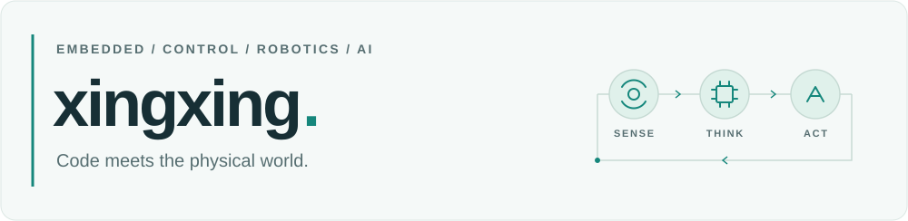
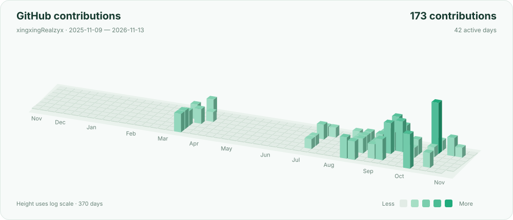

<picture>
  <source media="(prefers-color-scheme: dark)" srcset="assets/header-dark.svg">
  
</picture>

我是 **xingxing**，一名嵌入式软件工程师。探索自动控制、机器人与人工智能，把模型、代码和真实硬件连接起来。

Building at the intersection of embedded systems, control, and AI.

[个人网站 ↗](https://doublexing.cc) · [全部项目 ↗](https://github.com/xingxingRealzyx?tab=repositories)

### 技术栈 · Toolkit

| 方向 | 技术栈与实践 |
| :--- | :--- |
| **嵌入式系统** | `C / C++17` · `Rust` · `STM32` · `ESP32` · `Linux` · `Embassy` |
| **控制与机器人** | `LQR / MPC` · `Kalman Filter` · `dora-rs` · `ONNX` · 强化学习策略部署 |
| **AI 与开发工具** | `Python` · `LLM / VLM` · 多模态模型 · `Agent` · `CLI` |

### 代表项目 · Selected work

| 项目 | 在做什么 | 核心技术 |
| :--- | :--- | :--- |
| **[esp-duck](https://github.com/xingxingRealzyx/esp-duck)** | 将 Microduck 强化学习策略移植到 ESP32-S3，实现 50 Hz 推理与多策略切换。 | C++ · ESP32 · INT8 |
| **[embassy-dt](https://github.com/xingxingRealzyx/embassy-dt)** | 为 Embassy 构建异步设备树，让硬件描述与应用逻辑解耦。 | Rust · Embassy · STM32 |
| **[qmini-dora](https://github.com/xingxingRealzyx/qmini-dora)** | 机器人控制栈：连接手柄、IMU、电机与运动策略。 | Rust · dora-rs · ONNX |
| **[control-design](https://github.com/xingxingRealzyx/control-design)** | 从模型分析、离散化到控制器设计，导出可部署的 C++17 控制器。 | C++17 · LQR · MPC |
| **[tensor-to-world-book](https://github.com/xingxingRealzyx/tensor-to-world-book)** | 从张量、Transformer 到多模态模型，用图解与 TinyOmni 实训理解 AI。 | Transformer · Multimodal |
| **[xing-cli](https://github.com/xingxingRealzyx/xing-cli)** | 多语言包平台的命令行工具：检索组件、配置工具链、初始化开发环境。 | Rust · CLI · Toolchains |

### 持续构建 · Contributions in 3D

<picture>
  <source media="(prefers-color-scheme: dark)" srcset="assets/contribution-3d-dark.svg">
  
</picture>

近一年 GitHub 贡献，每日自动更新。柱高按对数缩放，兼顾日常积累与高峰。

---

也关注复杂性科学，相信量变引发质变。`xingxing` 是高中时期的绰号。

> 但行好事，莫问前程。
